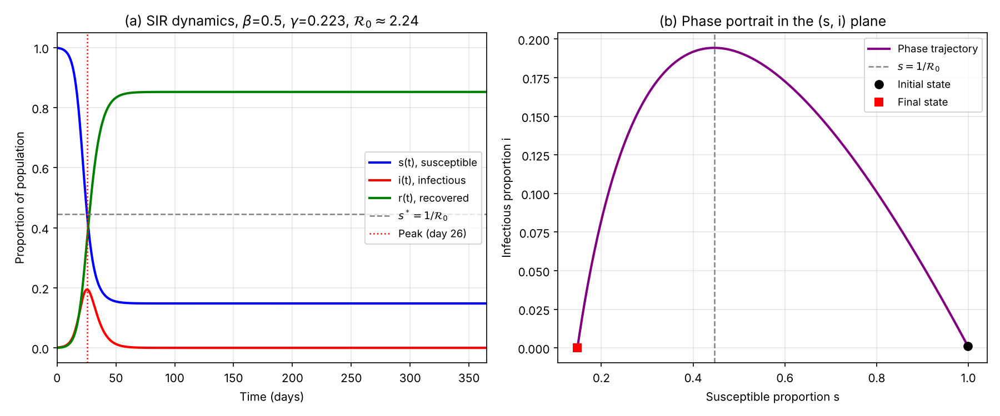
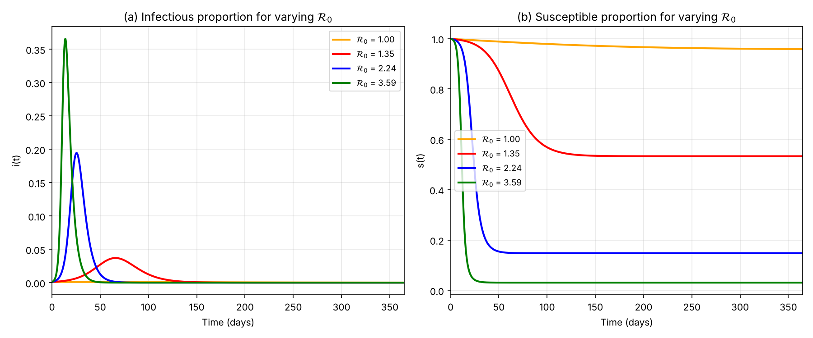
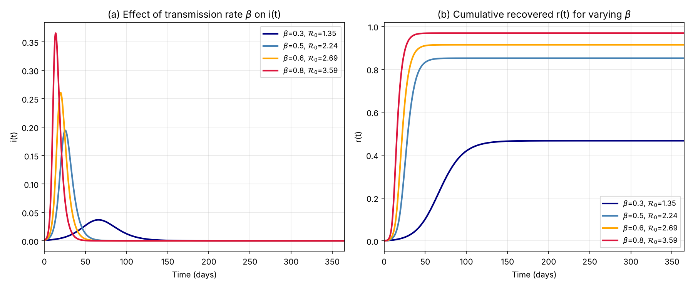
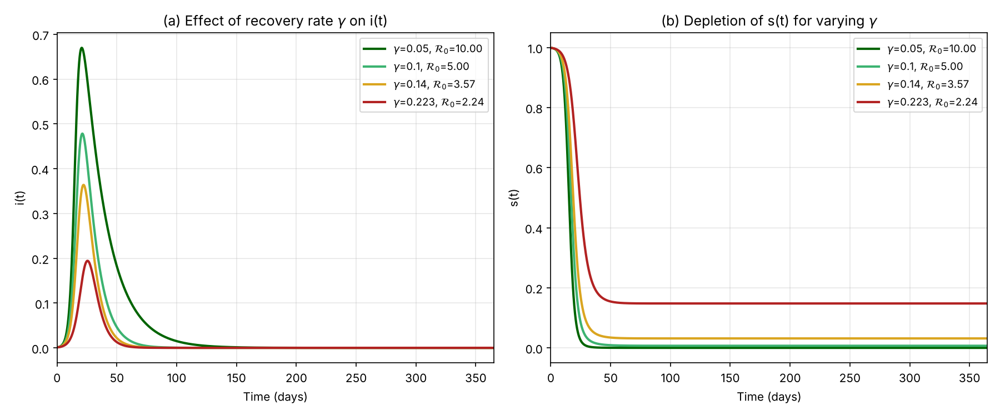

# Mathematical Modelling of the Spread of Syphilis Using the SIR Model

Final year project, BSc Industrial Mathematics (Applied with Computational Mathematics), University of Lagos, 2026.
**Author:** Victoria Abosede Fagbemiro &nbsp;|&nbsp; **Supervisor:** Professor O. J. Fenuga



## Overview
This project develops and analyses a Susceptible, Infectious, Recovered (SIR) model for the spread of syphilis in a closed, homogeneously mixing population. The analysis is carried out by hand; this repository contains the Python code used to simulate the model and confirm the analytical results.

## The model
With total population $N = S + I + R$ held constant:

$$\frac{dS}{dt} = -\frac{\beta S I}{N}, \qquad \frac{dI}{dt} = \frac{\beta S I}{N} - \gamma I, \qquad \frac{dR}{dt} = \gamma I$$

where $\beta$ is the effective contact (transmission) rate and $\gamma$ is the recovery rate.

## Analytical results
- **Basic reproduction number:** $\mathcal{R}_0 = \beta / \gamma$, obtained with the next generation matrix method.
- **Invariant region:** the feasible region is positively invariant.
- **Stability:** the disease-free equilibrium is locally asymptotically stable when $\mathcal{R}_0 < 1$, and globally asymptotically stable when $\mathcal{R}_0 \le 1$ (Lyapunov function with LaSalle's invariance principle).
- **Sensitivity analysis:** normalised forward sensitivity indices of $\mathcal{R}_0$ are $+1$ for $\beta$ and $-1$ for $\gamma$.
- **Final size relation:** $r_\infty = 1 - e^{-\mathcal{R}_0 r_\infty}$.

## Numerical results
Baseline parameters: $N = 10{,}000$, $I(0) = 10$, $\beta = 0.50$ per day, $\gamma = 0.223$ per day, so $\mathcal{R}_0 \approx 2.24$.

| Quantity | Value |
|---|---|
| Peak infectious proportion | 19.43% on day 25.5 |
| Simulated attack rate | 85.22% |
| Analytical final size | 85.19% |

The simulated attack rate agrees with the analytical final size relation, giving an independent check on the numerical work.

| Effect of $\mathcal{R}_0$ | Effect of $\beta$ | Effect of $\gamma$ |
|---|---|---|
|  |  |  |

## Conclusion
Because $\beta$ and $\gamma$ have sensitivity indices of equal size and opposite sign, cutting transmission (for example, condom use and screening) is as effective in lowering $\mathcal{R}_0$ as speeding up recovery (prompt diagnosis and treatment). A strategy that combines both is the most effective.

## Run it yourself
```bash
pip install -r requirements.txt
python sir_model.py
```
This prints the key results and saves all figures to `figures/`. The system is integrated with `scipy.integrate.solve_ivp` (adaptive Runge-Kutta, RK45); the original project notebook in `notebooks/` uses `scipy.integrate.odeint`, and both give the same results.

## Repository structure
```
sir_model.py                  clean script reproducing all results and figures
notebooks/My_Project_Graphs.ipynb   original Google Colab notebook
figures/                      generated figures
requirements.txt
```

## Limitations and future work
The basic SIR model assumes lasting immunity, a closed population and a single infectious stage. Natural extensions are an SIRS model with reinfection, vital dynamics for long-term endemic behaviour, and separate compartments for the primary, secondary, latent and tertiary stages of syphilis.
